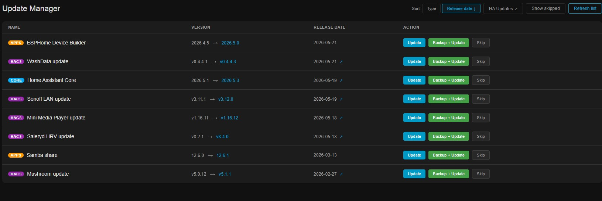
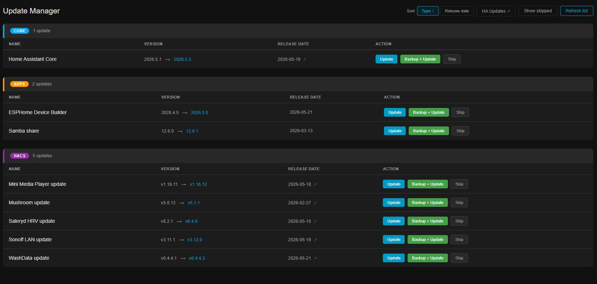
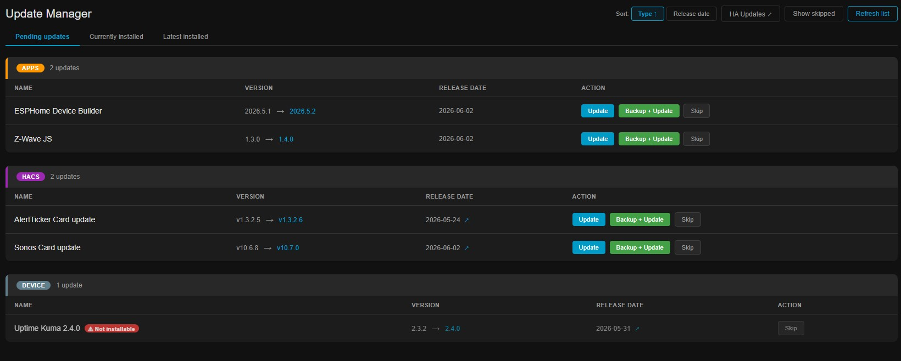
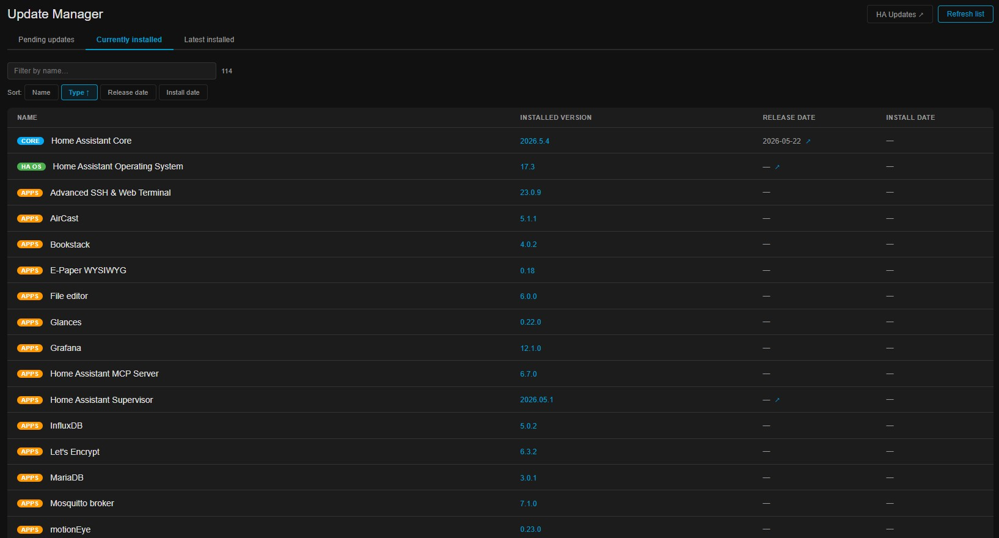
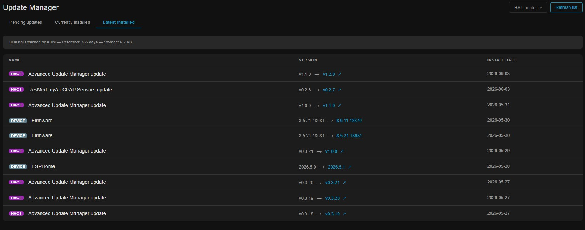

# Home Assistant Advanced Update Manager

[](https://ko-fi.com/finbom)
[](https://buymeacoffee.com/nkzdjs5gzk)

A HACS custom integration that adds a dedicated **Update Manager** panel to your Home Assistant sidebar — with enriched information that the built-in update UI doesn't show..

## Features

- **All update types in one view** — Core, HA OS, Add-ons, HACS integrations, Device firmware, and Other
- **Real release dates** — fetched from GitHub and cached persistently (survives restarts)
- **Direct links** to release notes for each update
- **Backup before update** — one-click backup + install
- **Skip** a specific version without losing the update notification
- **Real-time sync** — automatically reflects updates installed via the normal HA UI
- **Sensor entities** — expose update statistics to dashboards, automations, and scripts
- **🍀 Feeling Lucky mode** *(new, off by default)* — pick your pending updates and let AUM install them all, in a safe hardcoded order, unattended — see below

## Installation via HACS

1. Open HACS in your Home Assistant
2. Go to **Integrations** → click the three-dot menu → **Custom repositories**
3. Add `https://github.com/finbom/HomeAssistantAdvancedUpdateManager` with category **Integration**
4. Click **Add** → search for "Advanced Update Manager" and install it
5. Restart Home Assistant
6. Go to **Settings → Devices & Services → Add Integration** and search for "Advanced Update Manager"
7. Click **Submit** — a new **Update Manager** entry appears in the sidebar

## Manual installation

1. Copy `custom_components/advanced_update_manager` into your HA config's `custom_components/` directory
2. Restart Home Assistant
3. Go to **Settings → Devices & Services → Add Integration** and search for "Advanced Update Manager"

## How it works

- The integration registers itself as a **custom panel** in HA's sidebar (not an add-on, no separate Docker container)
- It runs inside HA's own process and subscribes to `update.*` entity state changes
- Release dates are fetched from the GitHub Releases API and stored persistently in `.storage/advanced_update_manager.json`
- Updates installed via the normal HA UI are automatically removed from the panel's list

## 🍀 Feeling Lucky mode

Home Assistant's own "update all" has no concept of order — it just fires every install at once. **Feeling Lucky** picks which of your pending updates to include, then runs them one at a time in a deliberate, safety-conscious order, unattended, surviving restarts along the way.

> **Off by default.** The engine has been validated end-to-end on a dedicated test instance: real HAOS/Core/HACS/add-on updates (including a real host reboot and a multi-version Core jump), "Make my crash" (no-backup mode), and a genuine deliberate failure correctly triggering Code Red and a Repairs issue. It's opt-in simply because it's new and does something powerful automatically — the usual "try it on a test instance first" caution applies to any new automation that installs updates unattended.

It's **hidden until you turn it on**: go to **Settings → Devices & Services → Advanced Update Manager → Configure** and enable **"Enable Feeling Lucky mode (Allow batch/multi-updates)"**. The 🍀 button in the panel toolbar only appears once this is on.

### How to use it

1. Click **🍀 Feeling Lucky** in the panel toolbar (only visible once enabled in the integration's options — see above). A checkbox appears next to every eligible pending update — everything is pre-checked **except device firmware**, which is opt-in only (it's the highest-risk category, since a bad OTA can brick a device).
2. An info box above the list explains the run order (collapsible — click **ⓘ Why this order?** any time to bring it back).
3. Pick one of the two commit buttons:
   - **Make my day — Install all selected with a Full backup** (the default, recommended path)
   - **Make my crash — Install all selected, but No backup** (danger mode — requires ticking an extra "I understand" box first)
4. A confirmation dialog shows the exact resolved order before anything runs.
5. Confirm, then walk away. The run continues in the background even if you close the tab, and survives Home Assistant restarting itself mid-sequence (which Core and OS updates do).

### The run order

```
Supervisor → HACS → Add-ons → Device firmware → HA OS → Core
```

- **Supervisor first** isn't a style choice — Home Assistant itself gates every other update on it.
- Everything else runs **lowest-risk, most-reversible first**, saving the two steps that require a restart or a full host reboot (HA OS, then Core) for last — by the time they run, everything else is already confirmed healthy on the current platform.
- Advanced Update Manager's own update is always excluded from the HACS phase — it doesn't update the code that's currently running the sequence.

### When something goes wrong: OPCON and Code Red

A new **OPCON** sensor tracks the health of the whole system: `ok` 🟢, `running` 🔵, or `critical` 🔴 (**Code Red**). The moment anything fails, the entire queue **freezes immediately** — nothing further starts, regardless of what phase it was in. This is deliberately a "blue screen," not a rollback: whatever already finished stays installed, and the frozen queue is left exactly as it was so you can see what completed, what was mid-install, and what never got a chance to start.

While OPCON is Code Red, both commit buttons are disabled (you can still install things manually through HA's normal update UI — Feeling Lucky just won't start a *new* automated run). The only way back to green is the **Reset OPCON** button — there's no implicit reset, starting a new run won't clear a stuck one.

A Code Red also raises a **Repairs** issue (**Settings → System → Repairs**) automatically — no setup needed. It clears itself when you hit Reset OPCON, so it can't go stale or drift out of sync with OPCON.

### New entities

| Entity | What it is |
|--------|-----------|
| **OPCON (Update Status)** sensor | `ok` / `running` / `critical`. Attributes: `last_error`, `since`, `backup_taken`. Deliberately a stable, automation-friendly state — safe to trigger alerts on. |
| **Feeling Lucky Queue** sensor | State = number of steps not yet done (`0` when idle). Attributes: the full `steps` list (each with phase, status, and error if any), `current_item`, `started_at` — the detailed, live view of what's happening. |
| **Reset OPCON (Clear Code Red)** button | Clears a Code Red and resets the queue. Also available as an action (below). |

As with the other sensors in this integration, entity IDs are device-scoped — check **Developer Tools → States** filtered on `advanced_update_manager` for the exact IDs in your install.

### New actions

| Action | What it does |
|--------|-------------|
| `advanced_update_manager.start_feeling_lucky` | Starts a run. Fields: `entity_id` (list of update entities to include), `backup` (boolean, default `true` — set `false` for danger mode). Refuses to start while OPCON is Code Red. |
| `advanced_update_manager.reset_opcon` | Clears Code Red and resets the queue — the same thing the button does, useful for automations. |

### Notification automation examples

The Repairs issue covers "something needs attention" if you check Settings regularly. For anything more immediate — a push to your phone, a dashboard banner — `sensor.opcon` is a plain state entity, so wire it up the same way as any other automation trigger. No extra configuration in the integration itself; pick whichever `notify.*` service you already use.

**Push notification the moment Code Red hits:**

```yaml
alias: Notify on Feeling Lucky Code Red
trigger:
  - platform: state
    entity_id: sensor.advanced_update_manager_opcon_update_status
    to: "critical"
action:
  - service: notify.mobile_app_your_phone
    data:
      title: "🔴 Code Red — Feeling Lucky stopped"
      message: "{{ state_attr('sensor.advanced_update_manager_opcon_update_status', 'last_error') }}"
```

**Persistent notification on the dashboard instead of (or alongside) a push:**

```yaml
alias: Persistent notification on Feeling Lucky Code Red
trigger:
  - platform: state
    entity_id: sensor.advanced_update_manager_opcon_update_status
    to: "critical"
action:
  - service: persistent_notification.create
    data:
      title: "Feeling Lucky — Code Red"
      message: "{{ state_attr('sensor.advanced_update_manager_opcon_update_status', 'last_error') }}"
      notification_id: aum_feeling_lucky_code_red
```

**Confirmation when a run finishes successfully** — useful since the whole point of Feeling Lucky is starting it and walking away:

```yaml
alias: Notify when Feeling Lucky finishes successfully
trigger:
  - platform: state
    entity_id: sensor.advanced_update_manager_opcon_update_status
    from: "running"
    to: "ok"
action:
  - service: notify.mobile_app_your_phone
    data:
      message: "✅ Feeling Lucky finished — all selected updates installed."
```

> Entity IDs above assume the default device-scoped naming — check **Developer Tools → States** if yours differ.

## Sensors

Advanced Update Manager creates a set of HA sensor entities grouped under a single **Advanced Update Manager** device in **Settings → Devices & Services**. Use them in dashboards, automations, and scripts.

> **Entity IDs are prefixed with the device name.** Because these sensors use HA's device-scoped naming, the entity ID is the device name and the sensor name slugified together — so the **Pending Updates** sensor is `sensor.advanced_update_manager_pending_updates`, *not* `sensor.pending_updates`. The full IDs are listed below. If you renamed the device or an entity, your IDs will differ — check **Developer Tools → States** and filter on `advanced_update_manager` to see the exact names in your install.

| Sensor | Example value | Description |
|--------|--------------|-------------|
| **Pending Updates**<br>`sensor.advanced_update_manager_pending_updates` | `7` | Total pending updates. Attributes include per-type counts: `core`, `haos`, `addon`, `hacs`, `device`, `other`. Ideal for sidebar badges or notification automations. |
| **Oldest Pending Update**<br>`sensor.advanced_update_manager_oldest_pending_update` | `47 days` | Age in days of the oldest available update (based on release date). Attributes identify the specific update. |
| **All Pending Updates**<br>`sensor.advanced_update_manager_all_pending_updates` | `7` | Full list of all pending updates exposed as the `pending_updates` attribute, sorted oldest-first. Each item includes `entity_id`, `title`, `type`, `installed_version`, `latest_version`, `release_date`, `days_pending`, `major_version_change`, `release_url`, and `skipped`. Use in notification automations to list every pending update, or filter in templates by type, age, or whether the version was skipped. |
| **Days Since Last Install**<br>`sensor.advanced_update_manager_days_since_last_install` | `12 days` | The "accident counter" — days since anything was installed. Resets to `0` on every install. Attributes show what was last installed. |
| **Last Installed**<br>`sensor.advanced_update_manager_last_installed` | `ESPHome 2025.5.1` | Name and version of the most recently installed update. Attributes include entity ID, type, from/to version, and install date. |
| **Updates Released This Week**<br>`sensor.advanced_update_manager_updates_released_this_week` | `4` | Number of pending updates released in the last 7 days. Spikes after major HA releases. |
| **Major Version Updates Pending**<br>`sensor.advanced_update_manager_major_version_updates_pending` | `1` | Count of updates where the major version number changed — a proxy for breaking changes. Attributes list the specific updates. |
| **History Log Size**<br>`sensor.advanced_update_manager_history_log_size` | `48 KB` | Size of the persistent storage file on disk. Use in automations to alert when the log grows unexpectedly large. |
| **Total Installs**<br>`sensor.advanced_update_manager_total_installs` | `312` | Lifetime count of all tracked installs in the retained history. |
| **Avg Days Release to Install**<br>`sensor.advanced_update_manager_avg_days_release_to_install` | `4.2 days` | Average time between a release being published and you installing it — your personal update hygiene score. |
| **Longest Gap Without Update**<br>`sensor.advanced_update_manager_longest_gap_without_update` | `34 days` | All-time record of the longest gap between consecutive installs — your personal best on the "accident counter". |
| **Most Updated Integration**<br>`sensor.advanced_update_manager_most_updated_integration` | `ESPHome` | The integration you have updated most often. Attributes include the install count and entity ID. |

## Automation & Dashboard Examples

The `sensor.advanced_update_manager_all_pending_updates` sensor exposes all pending updates as a list in the `pending_updates` attribute. Below are examples.

### Daily digest notification

Sends a morning summary of everything waiting to be installed. Skipped versions are excluded.

```yaml
alias: Daily pending update digest
trigger:
  - platform: time
    at: "09:00:00"
condition:
  - condition: numeric_state
    entity_id: sensor.advanced_update_manager_all_pending_updates
    above: 0
action:
  - service: notify.mobile_app_your_phone
    data:
      title: "{{ states('sensor.advanced_update_manager_all_pending_updates') }} pending updates"
      message: >
        
        
        • {{ u.title }} ({{ u.type }}) — {{ u.days_pending }} days old
        
```

---

### Immediate alert for major version changes

Fires as soon as a breaking update appears — useful for Core or add-ons where a major bump may require manual action.

Note that this keeps notifying while the update stays pending. A `state` trigger without `to:` also fires on attribute-only changes, and `days_pending` is recalculated on every coordinator refresh, so expect a reminder roughly once a day until you install or skip the update. If you would rather have a single alert each time the situation arises, trigger on `numeric_state` of `sensor.advanced_update_manager_major_version_updates_pending` with `above: 0` and drop the condition — the trade-off being that you get no new alert if a second breaking update shows up while the first is still pending.

```yaml
alias: Alert on major version update
trigger:
  - platform: state
    entity_id: sensor.advanced_update_manager_all_pending_updates
action:
  - condition: template
    value_template: >
      {{ state_attr('sensor.advanced_update_manager_all_pending_updates', 'pending_updates') | default([], true)
         | selectattr('major_version_change', 'eq', true) | list | count > 0 }}
  - service: notify.mobile_app_your_phone
    data:
      title: "Breaking update available"
      message: >
        
        
        ⚠️ {{ u.title }}: {{ u.installed_version }} → {{ u.latest_version }}
        {{ u.release_url }}
        
```

---

### Nag when updates have been waiting too long

Reminds you every morning about updates that have been available for more than 14 days and haven't been skipped.

```yaml
alias: Nag for stale updates
trigger:
  - platform: time
    at: "09:00:00"
action:
  - condition: template
    value_template: >
      {{ state_attr('sensor.advanced_update_manager_all_pending_updates', 'pending_updates') | default([], true)
         | selectattr('skipped', 'eq', false)
         | rejectattr('days_pending', 'none')
         | selectattr('days_pending', 'gt', 14) | list | count > 0 }}
  - service: notify.mobile_app_your_phone
    data:
      title: "Updates waiting over 14 days"
      message: >
        
        
        • {{ u.title }} — {{ u.days_pending }} days
        
```

---

### Dashboard markdown card

Shows all pending updates (excluding skipped) as a formatted table in any Lovelace dashboard.

```yaml
type: markdown
content: >
  ## Pending Updates
  
  
  
  | Name | Type | Waiting |
  |------|------|---------|
  
  | {{ u.title }} | {{ u.type }} | {{ u.days_pending if u.days_pending != none else '?' }} days |
  
  
  ✅ No pending updates.
  
```

---

## Update types

| Badge | Meaning |
|-------|---------|
| Core | Home Assistant Core |
| HA OS | Home Assistant Operating System |
| Add-on | Supervisor add-ons |
| HACS | HACS integrations, cards and themes |
| Device | Device firmware (ESPHome, Z-Wave, etc.) |
| Other | Anything else |

## Language / Translations

The panel automatically uses the same language as your Home Assistant UI (set under **Profile → Language**).

If no translation file exists for your language, the panel falls back to **English**.

### Currently supported languages

| Language | File |
|----------|------|
| English | `en.json` (default / fallback) |
| Swedish | `sv.json` |

### Contributing a translation

1. Fork this repository
2. Copy `custom_components/advanced_update_manager/frontend/translations/en.json` to a new file named with your language code (e.g. `de.json` for German, `nl.json` for Dutch — use the [BCP 47](https://www.iana.org/assignments/language-subtag-registry/language-subtag-registry) language tag that Home Assistant uses)
3. Translate all values in the new file — **do not change the keys**
4. Open a pull request

That's it. No changes to any Python or JavaScript files are needed.

## Screenshots

Sort by release date.


Sort by update type. (Core, HACS, Apps etc...)


Another screenshot.


View for what is currently installed.


View for what has been installed.



## License

MIT
